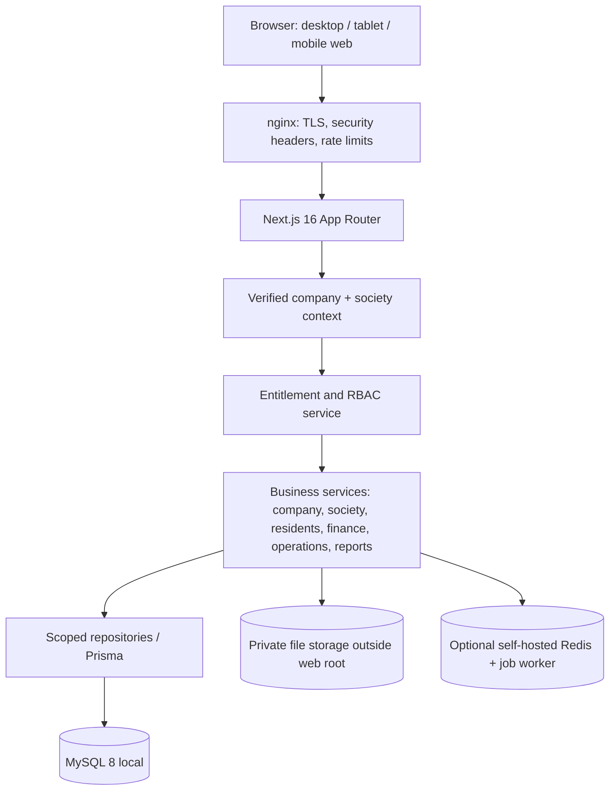

# Architecture

## 1. Shape of the system

The first release is a **modular monolith** deployed as one Next.js application backed by one local/self-hosted MySQL 8 database. Microservices are not introduced in this release (SRS §12, §23.11). Modules are logical boundaries inside one deployable, not separate services.



Hard constraints from the SRS:

- Next.js App Router, TypeScript, React, Tailwind CSS, Prisma, MySQL installed on the local machine/private server (SRS §11.1–11.3).
- No Docker, SQLite, PostgreSQL, or managed cloud database for this deployment (SRS §10, §11.3).
- Database access stays on the server; Prisma and credentials are never imported into client bundles (SRS §11.2).
- Server Components by default; Client Components only for interactive browser state.
- Middleware may filter navigation early, but it is never the final authorization boundary.

## 2. Request flow

Every protected screen, Server Action, and Route Handler follows the same order (SRS §8.5, §10.6, §14):

1. nginx terminates TLS, applies security headers and rate limits, and proxies to `127.0.0.1:3000`. No static route exposes private files.
2. Authentication resolves the session from an HttpOnly cookie; the user must be active.
3. Company context is derived from the user's **verified, active membership and explicit selection** — never from a `companyId` query parameter, form value, or unverified header.
4. Society context is validated against that membership where the request is society-scoped.
5. The entitlement service checks that the module is enabled and that the requested operation is allowed by its access mode.
6. The RBAC service checks permission for the module/resource/action.
7. The repository applies record-level data scope (`OWN`, `ASSIGNED`, `SOCIETY`, `COMPANY`, `PLATFORM`) in the query itself.
8. Inputs are validated at the trust boundary with shared Zod schemas from `packages/validation`.
9. Sensitive actions are written to `audit_logs` with actor, action, resource, result, reason, `request_id`, and UTC `created_at`.

Failures deny by default. Cross-tenant and out-of-scope records should be indistinguishable from "not found" to the caller.

## 3. Tenant isolation

### 3.1 MySQL caveat

SRS §6.3 mentions MySQL Row-Level Security "where compatible". **MySQL 8 does not provide PostgreSQL-compatible row-level security.** Do not claim RLS as an isolation control for this deployment. If a compatible RLS-like mechanism is later evaluated, it may be added as an extra layer only; it never replaces application authorization.

The enforced isolation controls are:

- `company_id` on every company-owned business table; `society_id` on society-owned tables.
- Server-derived company context from verified membership; browser-supplied company IDs are rejected.
- Scoped repository queries that always include the active `company_id` (and `society_id`/record scope where applicable).
- **Composite foreign keys** that make cross-company relationships invalid at the database level.
- Separate platform-level authorization for Super Admin operations.
- Automated cross-company and cross-society isolation tests for every major resource (SRS §6.2, §20.1).
- Time-bound, approved, visibly bannered, immutable-audited support elevation if implemented (SRS §5.1, §6.2, §15.5).

### 3.2 Composite foreign key strategy

Parent keys are made unique together with `company_id`, and children carry and reference both columns. This prevents a flat in company A from pointing at a building in company B.

```sql
-- Illustrative only; authoritative definitions live in packages/database.
CREATE TABLE companies (
  id CHAR(36) NOT NULL PRIMARY KEY
);

CREATE TABLE societies (
  id CHAR(36) NOT NULL,
  company_id CHAR(36) NOT NULL,
  PRIMARY KEY (id),
  UNIQUE KEY uq_societies_id_company (id, company_id),
  CONSTRAINT fk_societies_company FOREIGN KEY (company_id) REFERENCES companies (id)
);

CREATE TABLE buildings (
  id CHAR(36) NOT NULL,
  company_id CHAR(36) NOT NULL,
  society_id CHAR(36) NOT NULL,
  PRIMARY KEY (id),
  UNIQUE KEY uq_buildings_id_company (id, company_id),
  CONSTRAINT fk_buildings_society_company
    FOREIGN KEY (society_id, company_id) REFERENCES societies (id, company_id)
);

CREATE TABLE flats (
  id CHAR(36) NOT NULL,
  company_id CHAR(36) NOT NULL,
  building_id CHAR(36) NOT NULL,
  PRIMARY KEY (id),
  UNIQUE KEY uq_flats_id_company (id, company_id),
  CONSTRAINT fk_flats_building_company
    FOREIGN KEY (building_id, company_id) REFERENCES buildings (id, company_id)
);

CREATE TABLE invoices (
  id CHAR(36) NOT NULL,
  company_id CHAR(36) NOT NULL,
  flat_id CHAR(36) NOT NULL,
  PRIMARY KEY (id),
  CONSTRAINT fk_invoices_flat_company
    FOREIGN KEY (flat_id, company_id) REFERENCES flats (id, company_id)
);
```

Application scoping remains mandatory: constraints prevent invalid *relationships*, but only scoped queries prevent one company from reading another company's otherwise-valid rows. Platform tables (for example `modules`, `permissions`, `system_settings`) are not company-scoped and are reachable only through platform authorization.

## 4. Service and repository boundaries

| Layer | Owns | Must not do |
| --- | --- | --- |
| UI (App Router pages/components) | Rendering, loading/empty/error states, accessible forms | Contain business rules or call Prisma directly |
| Server Actions / Route Handlers | Trust-boundary validation, invoking services, audit for sensitive actions | Skip authorization because a page already checked it |
| `packages/validation` | Zod schemas shared by UI and server | Trust client input without server revalidation |
| `packages/authorization` | Session/context resolution, RBAC evaluation, entitlement checks | Query business tables directly |
| `packages/shared` | Types, constants, result/error envelopes, utilities | Hold secrets or database code |
| Business service (per module) | Use cases, transaction boundaries, approval rules, audit events | Bypass entitlement, tenant scope, or validation services |
| Repository (Prisma in `packages/database`) | Scoped CRUD, composite-FK-aware writes, pagination | Accept an unscoped company ID from the caller |
| Adapters | Private file storage, future S3-compatible storage, external providers | Leak provider details into business modules |

A module may not call another module's repository directly; it calls that module's service. Cross-cutting concerns (auth, tenant context, entitlement, audit, validation) are shared and cannot be implemented differently per module.

## 5. Module entitlements

`company_modules` stores `FULL`, `READ_ONLY`, or `DISABLED` per company/module (SRS §7.4). Stable module keys and dependencies are catalogued in [module-catalog.md](module-catalog.md).

When a module is disabled: hide navigation and entry points, reject direct URLs, reject APIs/Server Actions, reject background jobs, and prevent new records. **Historical data is preserved.** The default is read-only access for specifically authorized users with no new transactions, unless a company contract requires full restriction (SRS §7.2, §23.8). Entitlement changes are audited at platform level.

The Super Admin cannot enable a module while a required dependency is disabled; the UI must explain the dependency (SRS §7.3).

## 6. Background jobs

Use a job mechanism only where required (SRS §19). If Redis is introduced it is self-hosted/private. Candidate jobs: scheduled invoice generation, payment reconciliation, notification delivery, report generation, expiring visitor approvals, SLA reminders, file scanning.

Every job must:

- carry verified company context and recheck entitlement/RBAC where relevant;
- be idempotent, using `idempotency_records` where a financial or external effect is possible;
- have retry limits, recorded execution status, and failed-job/dead-letter review;
- avoid duplicate financial effects;
- go through the same service layer as interactive requests, never straight to unscoped repositories.

`outbox_events` supports reliable dispatch of post-transaction work. No gateway webhook handling is active until a provider is approved (SRS §2.2, §9.6, §23.10).

## 7. Deployment and operations boundary

- Web process binds to `127.0.0.1:3000`; nginx is the public entry point with TLS and headers ([nginx config](../infrastructure/nginx/society-management.conf)).
- MySQL binds to `127.0.0.1` (or a private network address, never the public internet) with a least-privilege runtime user.
- Private documents live outside the public web root and are streamed only after authorization through the app (SRS §18).
- Native host service notes and firewall rules are in [`native host installation`](../infrastructure/native%20host%20installation/README.md).
- Backup scripts and restore drills are in [`infrastructure/backup`](../infrastructure/backup/README.md).
- Health checks, audit review, and incident pointers are in [runbook.md](runbook.md).
