# Database design

## 1. Database standards

From SRS §13.1:

- **MySQL 8**, self-hosted/local via `127.0.0.1` or a private network; Prisma with `@prisma/adapter-mariadb`; no Docker/SQLite/Postgres/managed cloud database.
- UUID primary keys for major entities (`CHAR(36)` in MySQL or Prisma `String @db.Char(36)`).
- Foreign keys and appropriate unique constraints; indexes on company, society, status, date, and commonly searched columns.
- `created_at` and `updated_at` on all major tables; `created_by`/`updated_by` where applicable.
- `company_id` on company-owned tables; `society_id` on society-owned tables.
- Money as `DECIMAL` (or integer minor units) with a stored currency code — never floating point.
- Timestamps stored in **UTC**; timezones applied at the presentation layer.
- Migrations committed in `packages/database`; no manual production schema changes.
- Posted financial records are immutable; corrections use reversal entries.

The SRS notes that the full ERD, column types, indexes, constraints, and Prisma models are a separate technical design deliverable before production implementation (§13.2). This document provides the core ER diagram and the cross-tenant constraint strategy; the authoritative schema is the committed Prisma schema/migrations.

## 2. Entity groups

From SRS §13.2:

| Group | Tables |
| --- | --- |
| Platform and company | `companies`, `company_settings`, `modules`, `module_dependencies`, `company_modules`, `module_feature_limits` |
| Identity and access | `users`, `sessions`, `user_memberships`, `roles`, `permissions`, `role_permissions`, `user_roles`, `invitation_tokens` |
| Society and property | `societies`, `buildings`, `floors`, `flats`, `flat_ownerships`, `tenancies`, `family_members`, `vehicles`, `parking_slots`, `parking_allocations` |
| Finance | `charge_types`, `billing_rules`, `invoices`, `invoice_items`, `payments`, `payment_events`, `refunds`, `accounts`, `journal_entries`, `journal_lines`, `expenses`, `expense_approvals`, `bank_transactions`, `maintenance_expenses` |
| Operations | `gates`, `visitors`, `visitor_approvals`, `visitor_sessions`, `complaint_categories`, `complaints`, `complaint_assignments`, `complaint_comments`, `amenities`, `amenity_slots`, `bookings`, `employees`, `attendance`, `shifts`, `vendors`, `contracts`, `work_orders` |
| Communication and governance | `notices`, `notifications`, `notification_preferences`, `documents`, `document_permissions`, `meetings`, `meeting_agendas`, `meeting_attendance`, `voting_sessions`, `voting_eligibility`, `votes`, `meeting_minutes` |
| Security and system | `audit_logs`, `login_history`, `security_events`, `idempotency_records`, `outbox_events`, `system_settings` |

## 3. Composite FK strategy for tenant isolation

MySQL 8 has no native PostgreSQL-style row-level security. Isolation therefore combines:

1. `company_id` on every company-owned table and `society_id` on society-owned tables.
2. Scoped repository queries using the company context derived from verified membership — never a browser-supplied ID.
3. Composite FKs that make cross-company links invalid: parent tables expose a unique `(id, company_id)` key, and children reference both columns.

```sql
-- Pattern used for company-scoped hierarchies (illustrative).
CREATE TABLE societies (
  id CHAR(36) NOT NULL,
  company_id CHAR(36) NOT NULL,
  PRIMARY KEY (id),
  UNIQUE KEY uq_societies_id_company (id, company_id),
  CONSTRAINT fk_societies_company FOREIGN KEY (company_id) REFERENCES companies (id)
);

CREATE TABLE buildings (
  id CHAR(36) NOT NULL,
  company_id CHAR(36) NOT NULL,
  society_id CHAR(36) NOT NULL,
  PRIMARY KEY (id),
  UNIQUE KEY uq_buildings_id_company (id, company_id),
  CONSTRAINT fk_buildings_society_company
    FOREIGN KEY (society_id, company_id) REFERENCES societies (id, company_id)
);

CREATE TABLE flats (
  id CHAR(36) NOT NULL,
  company_id CHAR(36) NOT NULL,
  building_id CHAR(36) NOT NULL,
  PRIMARY KEY (id),
  UNIQUE KEY uq_flats_id_company (id, company_id),
  CONSTRAINT fk_flats_building_company
    FOREIGN KEY (building_id, company_id) REFERENCES buildings (id, company_id)
);
```

The same pattern applies to `invoices`/`flats`, `complaints`/`flats`, `bookings`/`amenity_slots`, and other company-scoped relations. Full enforcement still requires application-level scoping for every read, update, delete, export, download, and job; constraints alone do not hide valid rows from a cross-tenant query. Platform tables such as `modules` and `permissions` are not company-scoped and are governed by platform authorization.

## 4. Core ER diagram

A tool-agnostic Mermaid ER diagram is acceptable for the technical design (SRS §22). This diagram covers the core platform, identity, and RBAC tables.

```mermaid
erDiagram
    COMPANIES ||--o| COMPANY_SETTINGS : has
    COMPANIES ||--o{ COMPANY_MODULES : configures
    MODULES ||--o{ COMPANY_MODULES : "entitled via"
    MODULES ||--o{ MODULE_DEPENDENCIES : "depends on"
    MODULES ||--o{ MODULE_FEATURE_LIMITS : limits
    COMPANIES ||--o{ MODULE_FEATURE_LIMITS : limits
    COMPANIES ||--o{ USER_MEMBERSHIPS : scopes
    USERS ||--o{ USER_MEMBERSHIPS : holds
    USERS ||--o{ SESSIONS : has
    USERS ||--o{ USER_ROLES : assigned
    ROLES ||--o{ USER_ROLES : granted_through
    COMPANIES ||--o{ USER_ROLES : scopes
    ROLES ||--o{ ROLE_PERMISSIONS : contains
    PERMISSIONS ||--o{ ROLE_PERMISSIONS : included_in
    COMPANIES ||--o{ INVITATION_TOKENS : invites_for
    USERS ||--o{ INVITATION_TOKENS : invited
    USERS ||--o{ AUDIT_LOGS : actor
    COMPANIES ||--o{ AUDIT_LOGS : "optional scope"

    COMPANIES {
        uuid id PK
        string name
        string status
        datetime created_at
        datetime updated_at
    }
    COMPANY_SETTINGS {
        uuid id PK
        uuid company_id FK
        string settings_json
    }
    MODULES {
        uuid id PK
        string module_key
        boolean is_core
        boolean is_active
    }
    MODULE_DEPENDENCIES {
        uuid id PK
        uuid module_id FK
        uuid depends_on_module_id FK
    }
    COMPANY_MODULES {
        uuid id PK
        uuid company_id FK
        uuid module_id FK
        string access_mode
        datetime enabled_at
        datetime disabled_at
        string changed_by
        string reason
    }
    MODULE_FEATURE_LIMITS {
        uuid id PK
        uuid company_id FK
        uuid module_id FK
        string feature_key
        string limit_value
        string configuration_json
    }
    USERS {
        uuid id PK
        string email
        string password_hash
        string status
    }
    SESSIONS {
        uuid id PK
        uuid user_id FK
        datetime expires_at
        datetime revoked_at
    }
    USER_MEMBERSHIPS {
        uuid id PK
        uuid user_id FK
        uuid company_id FK
        uuid society_id
        string status
    }
    ROLES {
        uuid id PK
        string scope_type
        uuid company_id
        uuid society_id
        string role_key
        boolean is_system_role
    }
    PERMISSIONS {
        uuid id PK
        string module_key
        string resource_key
        string action
    }
    ROLE_PERMISSIONS {
        uuid id PK
        uuid role_id FK
        uuid permission_id FK
        string data_scope
    }
    USER_ROLES {
        uuid id PK
        uuid user_id FK
        uuid role_id FK
        uuid company_id
        uuid society_id
        uuid assigned_by
        datetime expires_at
    }
    INVITATION_TOKENS {
        uuid id PK
        uuid company_id FK
        uuid user_id FK
        datetime expires_at
    }
    AUDIT_LOGS {
        uuid id PK
        uuid company_id
        uuid society_id
        uuid actor_user_id FK
        string action
        string resource_type
        string resource_id
        string result
        string reason
        string request_id
        datetime created_at
    }
```



`COMPANY_MODULES.access_mode` is `FULL`, `READ_ONLY`, or `DISABLED` (SRS §7.4). `DISABLED` preserves historical records and defaults to read-only access for specifically authorized users; it never means deleting data.
